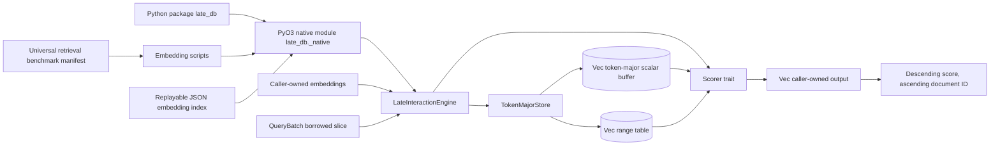
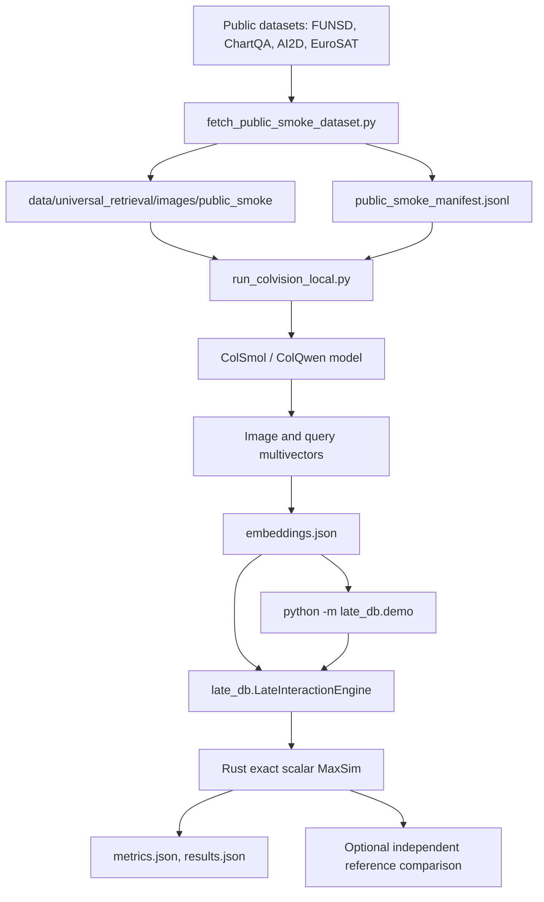

# late_db Architecture

This document is the running system diagram for the in-memory multimodal
late-interaction engine. Update it whenever module boundaries, storage layout,
or execution flow changes.

## Current System

## Benchmark Architecture

## Module Boundaries

- `config`: local-first limits and scale-ready execution knobs.
- `layout`: global token-major storage, document ranges, and zero-copy views.
- `engine`: orchestration, validation, and output-buffer reuse.
- `python`: PyO3 facade exposing configuration, ingestion, and ranked search.
- `scoring`: exact scalar MaxSim and the replaceable `Scorer` interface.
- `error`: explicit failure modes for shape, capacity, and range validation.
- `benchmarks/universal_retrieval`: manifest schema and seed task plan for
  cross-domain image retrieval experiments.

## Python API And Packaging

`LateInteractionEngine(embedding_dim, max_resident_tokens=250_000,
max_query_tokens=512)` accepts nested token vectors through
`add_document(document_id, embeddings, modality="image")` and returns
`(document_id, score)` pairs from `search(query_embeddings, top_k=5)`.
`document_count`, `token_count`, and `embedding_dim` are read-only properties.

Python lists are converted into Rust-owned buffers at the boundary. The
zero-copy slices described below apply inside Rust, not to Python ingestion.

- Build Python wheels with `maturin`.
- Keep the Rust crate as both `rlib` for Rust users and `cdylib` for Python
  extension builds.
- Expose only stable, high-level Python wrappers from `python/late_db`.
- Keep benchmarking and notebook ergonomics in Python while preserving Rust
  ownership of storage and scoring internals.
- The existing wheel CI builds Linux, macOS, and Windows artifacts.

## Storage Invariants

- `TokenMajorStore::scalar_buffer()` is a flat token-major buffer:
  `[token0_dim0..token0_dimN, token1_dim0..]`.
- `DocumentRange::{start_token, token_len}` are measured in tokens, not scalar
  elements.
- Scalar offsets are derived only at view/scoring boundaries using
  `EmbeddingDim`.
- `document_embeddings` returns a borrowed slice; it does not copy document
  vectors.
- Engine-level insertion enforces `max_resident_tokens` before mutating storage.
- IDs are unique. Empty documents and non-finite vectors are rejected before
  insertion. Query dimensions and token limits are checked before scoring.

## Scoring And Ranking

The implemented baseline computes, for each query token, the maximum dot
product across a document's tokens, then sums those maxima. Negative maxima are
preserved. It performs an exact scan of every stored document and rejects
non-finite intermediate scores.

Search sorts scores descending and breaks ties by ascending numeric document
ID. Ranking is deterministic. This baseline uses scalar arithmetic; it does not
yet implement SIMD, parallel scoring, approximate indexing, or modality fusion.
Modality labels describe records and do not change the scoring formula.

## Replayable Embedding Index

The benchmark runner emits a JSON object containing `schema_version: 1`,
`model_id`, `embedding_dim`, `image_embeddings`, and `query_embeddings`.
Image entries contain `image_id`, original manifest `record`, and nested
`vectors`. Query entries contain query metadata under `query` and nested
`vectors`. The runner also records embedding device and dtype.

`--embeddings-in PATH` rebuilds the in-memory Rust corpus and evaluates cached
queries without loading model dependencies. `--verify-native` compares every
Rust score against an independent CPU Torch reference, with a pure-Python
fallback for small indexes. The interactive CLI chooses among cached queries;
it does not encode arbitrary new text.

JSON is a portable demo interchange format, not a compact database persistence
format. Its nested arrays are intentionally easy to inspect, but grow large as
the corpus expands. Raw data, model caches, and generated indexes live under
ignored `data/`; learning-only artifacts are also ignored separately.

## Local-to-Cloud Notes

- Local defaults cap resident tokens and query tokens to avoid memory blowups.
- The scorer receives borrowed slices and range descriptors, so the compute
  layer can later move to Rayon, explicit SIMD, GPU kernels, or distributed
  workers without changing ingestion boundaries.
- GPU runtimes accelerate embedding. Scoring still runs through the CPU Rust
  engine, which makes cloud-generated embeddings replayable locally.
