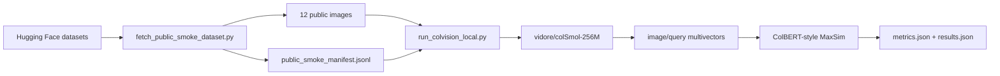

# Retrieval Results Analysis

## Current Evidence

The historical runs below used `colpali-engine` scoring; they did not exercise
the Rust retrieval engine. The current runner scores through Rust and writes a
replayable `embeddings.json`, with `--verify-native` available for independent
score comparison. Keep new native results separate from these historical runs.

## Verified Native Smoke Run

The current runner completed an offline end-to-end run using the repository's
cached `vidore/colSmol-256M`, all 12 public images, and all 24 queries. Image and
query vectors were ingested into `late_db.LateInteractionEngine`; all 288 native
query/document scores were checked against an independent CPU Torch MaxSim.

| Metric | Result |
|---|---:|
| Recall@1 | 0.375 |
| Recall@5 | 0.833333 |
| MRR | 0.565741 |
| nDCG@5 | 0.618064 |
| Maximum native/reference absolute score error | 0.00000190735 |
| Image embedding time | 108.42 s |
| Query embedding time | 1.15 s |
| Native scoring time, debug build | 12.53 s |

These retrieval metrics reproduce the historical public smoke run. The native
timing uses an unoptimized development extension and should not be compared to
the historical processor timing as a release-performance benchmark.

Replaying the same saved vectors after `maturin develop --release` scored all
24 queries in 0.422 s, excluding model work and reference verification. All 288
scores again matched Torch within 0.00000190735; retrieval metrics were unchanged.
The release replay is saved under
`data/universal_retrieval/runs/native_public_smoke_release_replay/`.

Local artifacts are saved under the ignored directory
`data/universal_retrieval/runs/native_public_smoke_colsmol_256m_cpu/`. The
`embeddings.json` index supports repeatable retrieval without loading a model:

```sh
python -m late_db.demo \
  --embeddings data/universal_retrieval/runs/native_public_smoke_colsmol_256m_cpu/embeddings.json \
  --query-id public_funsd_02_q_direct --top-k 3
```

The public sample contains three pairs of byte-identical images with different
IDs: the two ChartQA images, AI2D images 1/2, and AI2D images 3/4. Existing strict
single-positive labels are preserved in this run, so metrics remain smoke-test
evidence. Group equivalent positives or deduplicate before the next benchmark.

## Historical Processor Runs

Earlier CPU runs with `vidore/colSmol-256M`:

| Run | Images | Queries | Recall@1 | Recall@5 | MRR |
|---|---:|---:|---:|---:|---:|
| synthetic smoke | 12 | 24 | 1.000 | 1.000 | 1.000 |
| public smoke | 12 | 24 | 0.375 | 0.833 | 0.566 |
| FUNSD sanity rerun | 2 | 4 | 0.750 | 1.000 | 0.875 |

The synthetic run proves the pipeline works. The public run is the useful
signal.

## Public Smoke Flow



## Scanned Documents

FUNSD text-specific scanned-document queries both ranked the correct form first:

- Query containing `R&D Suggestion: Date: Licensee...` ranked `public_funsd_01`
  at rank 1.
- Query containing `PHOENIX ... CYPRUS NICOSIA` ranked `public_funsd_02` at
  rank 1.

The sanity rerun on only the two FUNSD images reproduced this behavior:

- Text queries: rank 1 for both documents.
- Generic layout query: rank 2 for one document and rank 1 for the other.

Interpretation: late-interaction visual retrieval is promising for scanned
documents when the query names visible text. It is weaker when the query is only
generic layout intent such as “noisy scanned form with boxed layout.”

## VQA-Like Queries

The public smoke set includes ChartQA and AI2D questions, which are VQA-style
queries used as retrieval prompts:

- ChartQA direct questions placed the matching chart family at the top, but the
  two selected ChartQA rows produced tied scores. This suggests the selected
  samples are visually near-duplicate or identical chart images with different
  questions.
- AI2D direct questions were mixed: some science-diagram questions ranked the
  correct image first, while others confused similar diagrams.

Interpretation: this approach can retrieve VQA evidence images when the visual
corpus has distinctive text/structure, but VQA rows need careful grouping.
Multiple questions over the same or visually near-identical image should share a
positive set rather than being scored as strict single positives.

## Image-General Retrieval

Remote-sensing results were weakest:

- Direct land-use class queries often failed at rank 1.
- Generic “satellite viewpoint” queries retrieved the remote-sensing cluster but
  confused individual labels.

Interpretation: ColSmol behaves more like a visual-document retriever than a
universal image embedding model. It captures OCR/document/chart/diagram cues
better than domain-specific natural or aerial-image semantics in this small CPU
test.

## Performance

On local CPU:

- Public image embedding took `224.25s` for 12 images.
- Query embedding took `1.39s` for 24 queries.
- Exact MaxSim scoring took `0.126s`.

The scoring engine direction is still valid: scoring is cheap at this scale
relative to image embedding. Local CPU is not a good environment for broad model
experiments.

## Decision

Continue the project, but narrow the next benchmark:

- Focus first on scanned documents, forms, charts, and diagrams.
- Use Colab GPU for 30-50 public document pages.
- Compare `colSmol-256M`, `colSmol-500M`, and `ColQwen2/ColQwen2.5`.
- Add single-vector baselines before claiming universal image retrieval.

Current conclusion: late interaction looks effective for scanned documents and
visual-document retrieval. It is not yet proven as a universal image retrieval
mechanism.
